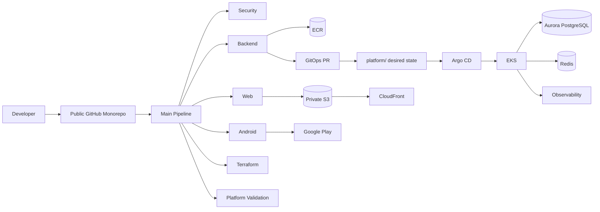
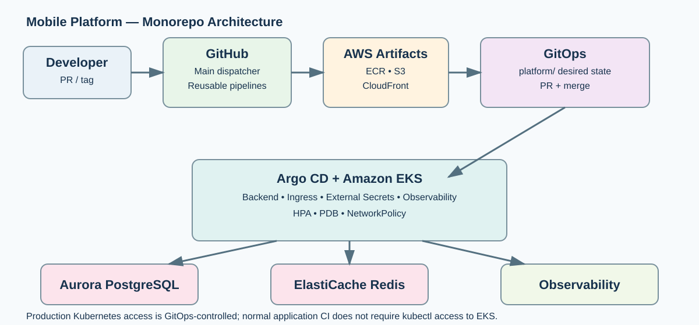
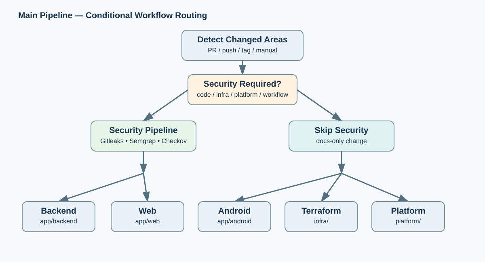
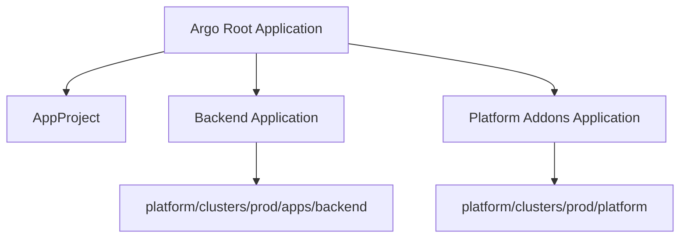
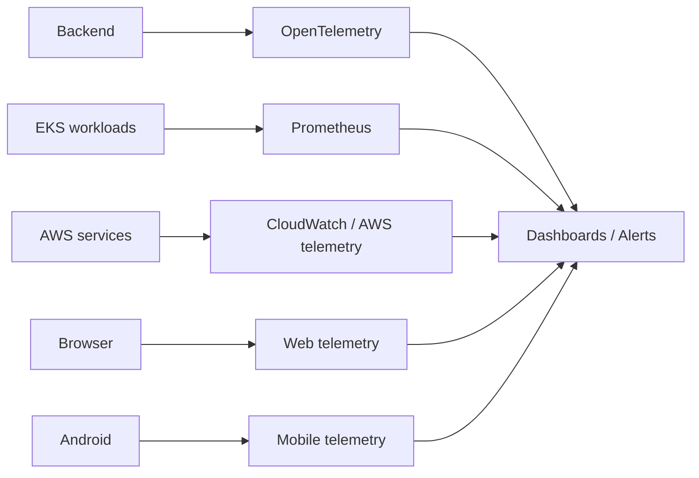

# Mobile Platform — GitHub Actions + Argo CD

> **Public monorepo reference implementation** for an Android + Web + Backend product running on AWS/EKS, with GitHub Actions for CI/CD and Argo CD for GitOps.

[](.github/workflows/main.yml)
[](platform/argocd)
[](infra)

This repository is deliberately structured as **one monorepo**. The application code, Terraform, Kubernetes desired state, Argo CD configuration, scripts, documentation, security policy and all CI/CD workflows live together.

## What this repository demonstrates

- Android application delivery to Google Play
- Static Web delivery through private S3 + CloudFront
- Backend container delivery through ECR + EKS
- GitHub Actions with reusable pipelines
- A **main dispatcher pipeline** that detects changed areas and invokes only the required pipelines
- AWS OIDC authentication from GitHub Actions without long-lived AWS keys
- Argo CD App-of-Apps style GitOps
- Immutable container deployment by ECR digest
- Terraform infrastructure and protected production apply
- Security gates: Gitleaks, Semgrep, pip-audit, Checkov, Trivy, SBOM
- Kubernetes policy, HPA, PDB and observability building blocks

---

# 1. Architecture



For detailed diagrams see [`docs/architecture.md`](docs/architecture.md). Static diagrams are also checked into [`docs/diagrams`](docs/diagrams).





## Production deployment boundary

```text
GitHub Actions
    │
    ├── test / scan / build
    ├── publish immutable artifact
    └── create GitOps PR
             │
             ▼
      platform/ desired state
             │
          merge/review
             │
             ▼
          Argo CD
             │
             ▼
           EKS
```

**GitHub Actions is the delivery engine. Argo CD is the Kubernetes reconciler.** Routine production deployment should not depend on a CI runner executing imperative `kubectl apply`.

---

# 2. Monorepo Structure

```text
.
├── .github/
│   ├── workflows/
│   │   ├── main.yml
│   │   ├── security.yml
│   │   ├── backend.yml
│   │   ├── web.yml
│   │   ├── android.yml
│   │   ├── infra.yml
│   │   ├── platform.yml
│   │   └── bootstrap.yml
│   ├── CODEOWNERS
│   └── dependabot.yml
├── app/
│   ├── backend/
│   ├── web/
│   └── android/
├── infra/
│   ├── live/bootstrap/
│   ├── live/prod/
│   └── modules/
├── platform/
│   ├── argocd/
│   └── clusters/
├── docs/
├── scripts/
├── Makefile
├── SECURITY.md
├── CONTRIBUTING.md
└── LICENSE
```

---

# 3. The Main Pipeline

The main workflow is [`.github/workflows/main.yml`](.github/workflows/main.yml). It is the only workflow users need to think about for normal pull requests and pushes.

It first computes the changed areas, then calls reusable workflows using GitHub Actions reusable-workflow support. The dispatcher uses `needs` + `if` to conditionally invoke jobs.

| Changed path | Pipeline invoked |
|---|---|
| `app/backend/**` | Backend + Security |
| `app/web/**` | Web + Security |
| `app/android/**` | Android + Security |
| `infra/**` | Terraform + Security |
| `platform/**` | Platform validation + Security |
| `scripts/promote-gitops.sh` | Backend promotion + Security |
| Other `scripts/**` | Security |
| `.github/workflows/**` | Full pipeline |
| `docs/**` only | No build pipeline |

On an Android tag such as `android-v1.0.0`, the dispatcher starts the Android and security pipelines.

### Why use reusable workflows?

Each pipeline can be tested independently and can also be run directly from the Actions UI. The main workflow remains small and acts as the router. GitHub documents reusable workflows as a supported way to centralize repeatable CI/CD logic and allows called jobs to be gated with `if` and `needs`.

---

# 4. Pipeline Details

## Security

File: `.github/workflows/security.yml`

Runs repository-wide security controls when production-relevant code changes. It contains: Gitleaks, Semgrep, Python dependency auditing, Terraform Checkov and a public-repository sanity scan.

## Backend

File: `.github/workflows/backend.yml`

```text
validate → test → build → Trivy → SBOM → push ECR → resolve digest → GitOps PR
```

The deployed image is represented as:

```text
<registry>/<repository>@sha256:<digest>
```

not only by a mutable tag. The GitOps PR updates:

```text
platform/clusters/prod/apps/backend/kustomization.yaml
```

The promotion is now **same-repository GitOps** because the entire project is a monorepo.

## Web

File: `.github/workflows/web.yml`

The web build publishes immutable assets beneath:

```text
s3://<bucket>/releases/<commit-sha>/assets/
```

`index.html` remains the deployment pointer and is invalidated through CloudFront.

## Android

File: `.github/workflows/android.yml`

```text
android-vX.Y.Z tag
      │
      ▼
   testDebug
      │
      ▼
 signed release AAB
      │
      ▼
 Google Play internal
      │
 protected android-production environment
      │
      ▼
 production rollout
```

The same AAB is promoted; it is not rebuilt for production.

## Terraform

File: `.github/workflows/infra.yml`

Pull requests run formatting and validation. Pushes to `main` run plan and protected production apply.

## Platform

File: `.github/workflows/platform.yml`

Kustomize builds and YAML parsing validate the Argo/Kubernetes tree. Argo CD performs the actual reconciliation after changes reach `main`.

---

# 5. AWS Identity Model

GitHub Actions uses GitHub OIDC to obtain short-lived AWS credentials. No long-lived AWS access keys belong in GitHub secrets. The IAM role trust policy must be restricted to the intended repository/branch/environment subjects.

Configured roles include:

- Terraform infrastructure role
- ECR publishing role
- Web publishing role
- Argo CD bootstrap role

See [`infra/live/prod/main.tf`](infra/live/prod/main.tf) and [`docs/github-actions.md`](docs/github-actions.md).

---

# 6. Argo CD

Argo CD configuration lives under [`platform/argocd`](platform/argocd). The bootstrap installs Argo CD, then applies the root Application.



The root Application references the monorepo itself. Before first bootstrap, replace:

```text
<GITHUB_OWNER>
<GITHUB_REPOSITORY_NAME>
```

in [`platform/argocd/bootstrap/root-app.yaml`](platform/argocd/bootstrap/root-app.yaml).

---

# 7. Infrastructure

Terraform is under [`infra`](infra).

### Bootstrap

`infra/live/bootstrap` establishes the remote state foundation.

### Production

`infra/live/prod` creates the production VPC/EKS/data/ECR/web/GitHub OIDC stack.

The example Terraform variables intentionally contain placeholders and do not embed production secrets. See [`infra/live/prod/terraform.tfvars.example`](infra/live/prod/terraform.tfvars.example).

---

# 8. Kubernetes Runtime

Production manifests are under [`platform/clusters/prod`](platform/clusters/prod).

The backend includes: service account, deployment, service, ingress, HPA, PDB, NetworkPolicy, ExternalSecret and ServiceMonitor.

Platform components include: AWS Load Balancer Controller, External Secrets Operator, kube-prometheus-stack and OpenTelemetry Collector.

---

# 9. Observability



The codebase includes Kubernetes monitoring components and an OpenTelemetry Collector deployment. Product telemetry providers remain an account/application integration point and should be configured separately from the public code.

---

# 10. Production Configuration

Create these GitHub Environments:

### `production`

Used by Terraform, backend artifact publication and web publication. Configure environment approvals for production jobs.

Typical Variables:

```text
AWS_REGION
AWS_INFRA_ROLE_ARN
AWS_ECR_PUBLISH_ROLE_ARN
AWS_WEB_PUBLISH_ROLE_ARN
WEB_BUCKET
CLOUDFRONT_DISTRIBUTION_ID
GITOPS_APP_ID
```

### `production-bootstrap`

```text
AWS_REGION
AWS_ARGOCD_BOOTSTRAP_ROLE_ARN
EKS_CLUSTER_NAME
```

### `android-internal` and `android-production`

Store the Android signing material and Google Play service-account credentials only as protected secrets.

---

# 11. First-Time Setup

## A. Create the public GitHub repository

Recommended name:

```text
mobile-platform-github-argo
```

Do not enable public issue discussions until the security/maintenance policy is understood.

## B. Push this monorepo

```bash
git init
git branch -M main
git add .
git commit -m "feat: initial mobile platform monorepo"
git remote add origin https://github.com/<GITHUB_OWNER>/mobile-platform-github-argo.git
git push -u origin main
```

You can also use `scripts/publish-public.sh` with GitHub CLI after authenticating `gh`.

## C. Configure repository protection

Protect `main`. Require pull requests and the CI checks required by your organization. Create the environments listed above and add required reviewers for production.

## D. Configure GitHub App

Create a GitHub App used only for same-repository GitOps promotion. Grant only the permissions needed to create branches and pull requests in this repository. Store the App ID as a variable and the App private key as a protected secret.

## E. Configure AWS OIDC

Apply the Terraform configuration and use the generated role ARNs in GitHub Environments. GitHub's OIDC flow uses the repository identity to request short-lived AWS credentials; the AWS trust policy should constrain which subjects can assume each role.

## F. Bootstrap Argo CD

Install a self-hosted runner in the VPC with label `aws-private`. Manually run `.github/workflows/bootstrap.yml` using the `production-bootstrap` environment.

## G. Release

Merge backend/web code to `main`, or create an Android tag. The main dispatcher will run only the pipelines needed by the changed paths.

---

# 12. Public Repository Safety

The following must never be committed:

```text
AWS access keys
AWS secret keys
Android .keystore / .jks files
Google Play service-account JSON
GitHub App private key
Database passwords
JWT signing keys
OAuth client secrets
.env files with real credentials
Terraform state
```

Run:

```bash
./scripts/check-public-repo.sh
```

Security automation also runs Gitleaks.

---

# 13. Local Validation

```bash
make validate
```

Individual checks:

```bash
make backend-test
make web-test
make platform-build
make public-repo-check
```

---

# 14. Documentation

- [`docs/architecture.md`](docs/architecture.md) — system and pipeline diagrams
- [`docs/github-actions.md`](docs/github-actions.md) — workflow architecture
- [`docs/bootstrap.md`](docs/bootstrap.md) — infrastructure bootstrap
- [`docs/argocd.md`](docs/argocd.md) — GitOps/Argo CD
- [`docs/security.md`](docs/security.md) — security model
- [`docs/observability.md`](docs/observability.md) — observability
- [`docs/release-runbook.md`](docs/release-runbook.md) — release and rollback
- [`docs/production-readiness.md`](docs/production-readiness.md) — production checklist
- [`docs/development.md`](docs/development.md) — local development
- [`docs/publish.md`](docs/publish.md) — public GitHub publishing

---

# 15. Reference Status

This is a **production-oriented reference implementation**, not a claim that it can be applied to an arbitrary AWS account without configuration. Domain names, certificates, account IDs, least-privilege IAM policies, Google Play credentials, GitHub App settings and organization-specific controls must be supplied by the operator.

The code is intentionally public-safe: all account-specific and secret values are represented as variables, environment values or placeholders.
