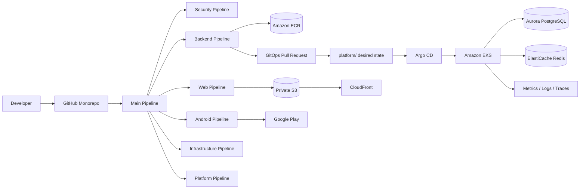
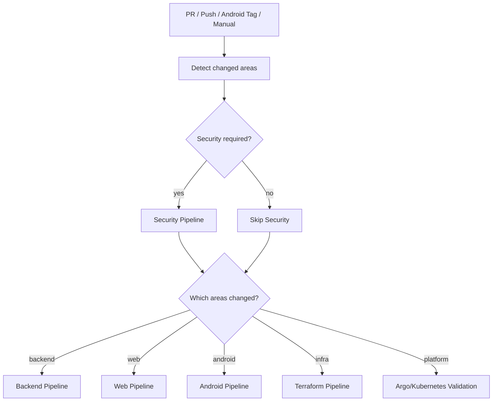
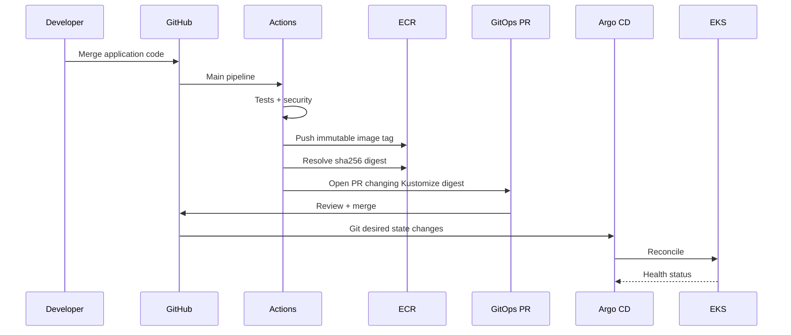

# Architecture

## System architecture



## Main pipeline decision model



## Production backend delivery



## Repository layout

```text
.
├── .github/
│   ├── workflows/            # main dispatcher + reusable workflows
│   ├── CODEOWNERS
│   └── dependabot.yml
├── app/
│   ├── backend/              # Python API + Dockerfile + tests
│   ├── web/                  # static frontend
│   └── android/              # Android + Fastlane
├── infra/
│   ├── live/bootstrap/       # Terraform state bootstrap
│   ├── live/prod/            # production root
│   └── modules/               # reusable AWS modules
├── platform/
│   ├── argocd/                # Argo CD Projects/Applications/bootstrap
│   └── clusters/              # desired Kubernetes state
├── docs/
└── scripts/
```
