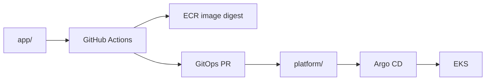

# Argo CD GitOps

Argo CD manages the Kubernetes desired state stored in this same monorepo. The root Application points to `platform/argocd`, which declares the product AppProject and child Applications.

## Deployment flow



## GitOps PR

The backend pipeline changes:

```text
platform/clusters/prod/apps/backend/kustomization.yaml
```

and pins the backend image by digest. The PR is reviewed and merged like any other production change.

## Bootstrap

The EKS API is private. The first Argo installation therefore runs from a self-hosted GitHub runner inside the AWS VPC. Routine application workflows do not need direct Kubernetes API access.

## Rollback

Rollback is a Git operation: revert the promotion commit/PR or restore a previously verified image digest. Argo CD reconciles the cluster back to that desired state.
